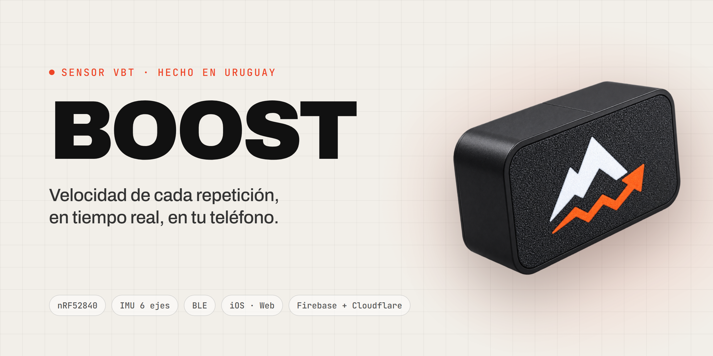
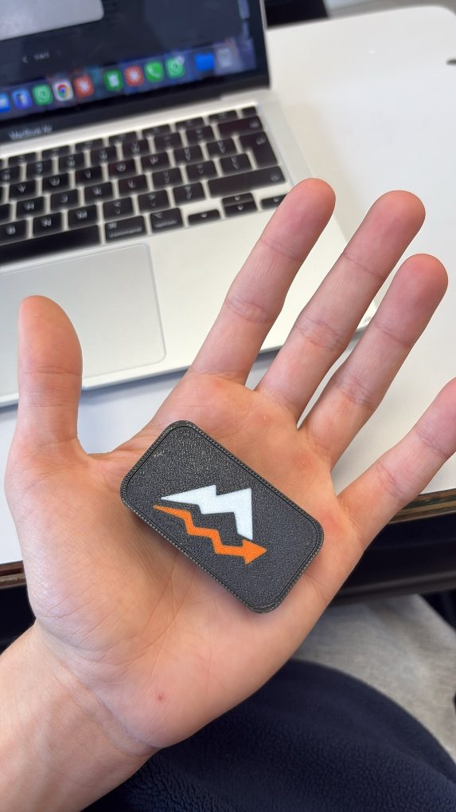
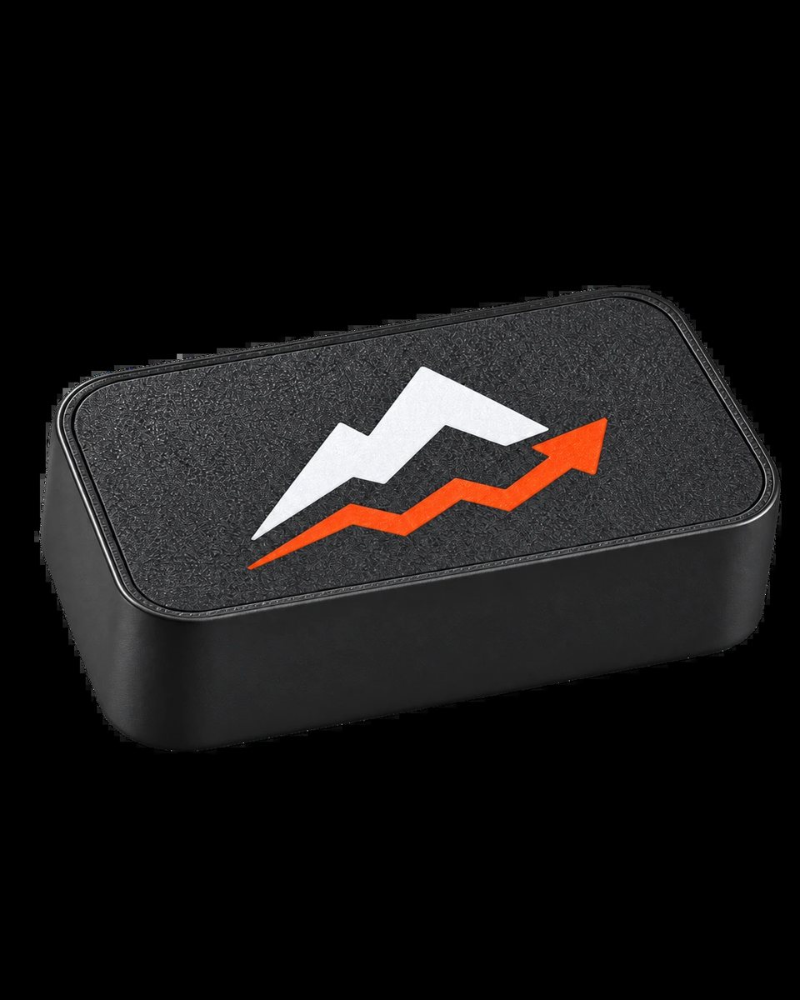
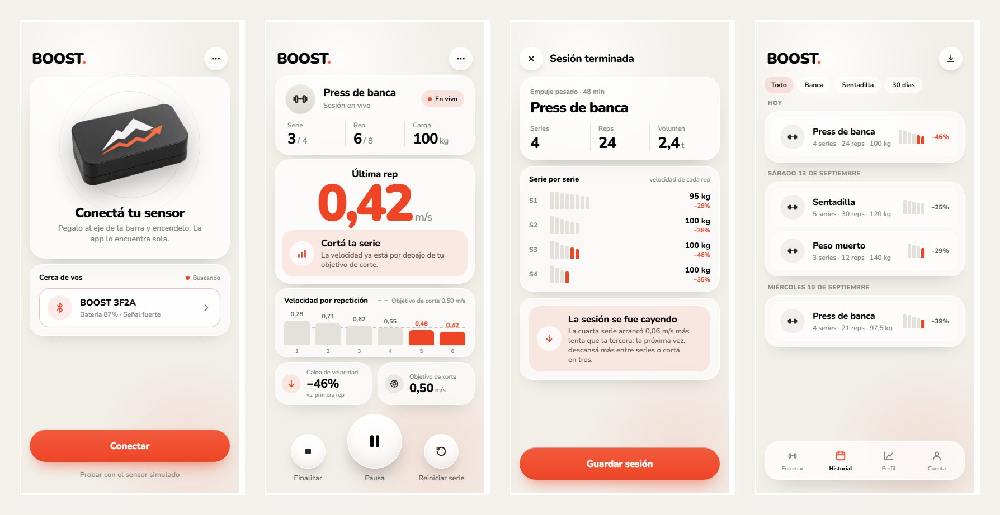
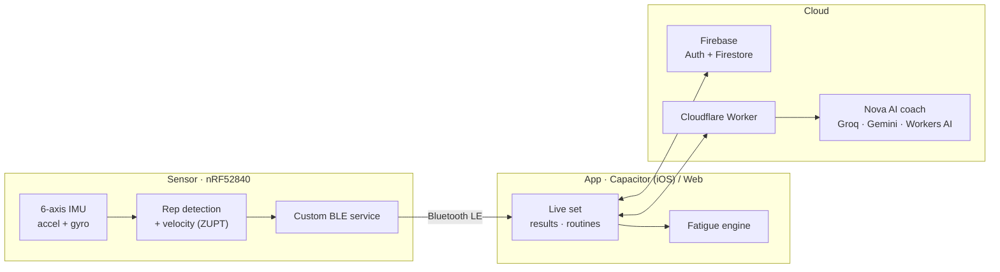

<p align="center">
  
</p>

<p align="center">
  <a href="https://getboost.fit"></a>
  <a href="https://app.getboost.fit"></a>
  
</p>

> 🇺🇾 BOOST es un sensor que se pega con imanes a la barra del gimnasio, mide la velocidad de cada repetición y te dice cuándo cortar la serie. Lo estoy desarrollando yo: hardware, firmware, app, back-end y marca.

# BOOST

**BOOST is a velocity-based training (VBT) sensor.** A 57 × 31 × 17 mm puck snaps onto the barbell with magnets, measures every rep with an IMU and sends it to the app over Bluetooth. From the speed of each rep the app knows how tired you are, and tells you when to stop the set before you pile up fatigue that doesn't make you stronger.

I'm building the whole product: hardware, firmware, iOS/web app, back-end, AI coach, website and brand.

<p align="center">
  
  
</p>

## The app



Connect the sensor → start a set → see each rep's speed live → the app tells you when velocity loss says "cut the set" → summary and history.

## How it works



| Part | What it does | Status |
|---|---|---|
| **Firmware** (C++, PlatformIO) | Self-calibrates while the bar rests, detects each rep, integrates velocity with zero-velocity updates (ZUPT), sends one packet per rep. Sleep, wake-on-shake, battery learning and a black-box log. | Complete. **52 tests** run on a PC against fakes of the I²C bus, NOR flash and BLE stack. |
| **App** (JavaScript, Capacitor 7, Swift) | Live set, velocity loss, history, routines. Native layer in Swift with a Live Activity on the lock screen. | Live at [app.getboost.fit](https://app.getboost.fit). iOS builds in the cloud (Codemagic / GitHub Actions). |
| **Back-end** | Firebase Auth + Firestore with tested security rules. Cloudflare Worker with rate limits, consent tracking and a daily cap. | Deployed. |
| **Nova, the AI coach** | Answers with the athlete's real data and a cited evidence base (author and year for every claim). The next load is calculated by the server, not by the model. Fallback across three LLM providers. | Deployed. |
| **Website** | Landing and waitlist. | Live at [getboost.fit](https://getboost.fit). |
| **Hardware** | Seeed XIAO nRF52840 Sense, LSM6DS3TR IMU, LiPo battery, neodymium magnets, 3D-printed case. | Prototype. |

**The test that validates the product:** count bench-press reps with 95 % accuracy in a real gym, checked against video. Current firmware metrics come from synthetic signals and I don't present them as real measurements yet.

## What's in this repository

This is the public showcase of BOOST. The firmware, the app and the back-end live in a private repository because they are the product.

```
landing/         public website (HTML/CSS/JS, no build, Cloudflare Pages)
design-system/   the app's design tokens and components (React + Vite)
docs/media/      product photos and app screens
```

Run the component gallery:

```bash
cd design-system
npm install
npm run dev
```

## Stack

| Layer | Tech |
|---|---|
| Hardware | nRF52840 · LSM6DS3TR IMU · LiPo · magnets · 3D-printed case |
| Firmware | C++ · PlatformIO · Bluetooth LE · host tests with `make` |
| App | JavaScript · Capacitor 7 · Swift (Live Activity, custom plugin) · RevenueCat |
| Back-end | Firebase Auth + Firestore · Cloudflare Workers |
| AI | Groq · Gemini · Workers AI |
| Web and design | HTML/CSS/JS · React + Vite |

## About

Designed and built by [Máximo Fynn](https://github.com/Fynnmn) in Uruguay, with an AI-assisted workflow (Claude Code). I'm looking for gyms and coaches who want to test it: [getboost.fit](https://getboost.fit).

Proprietary software and designs. © 2026 BOOST. See [LICENSE](LICENSE).
