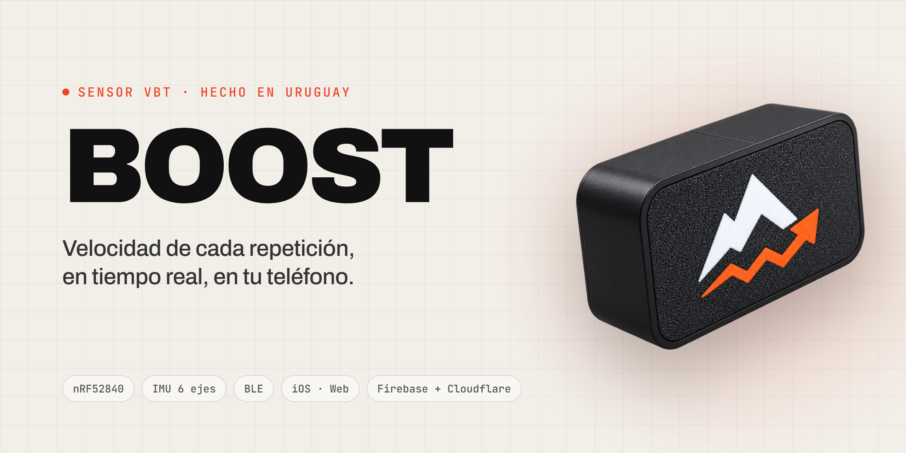
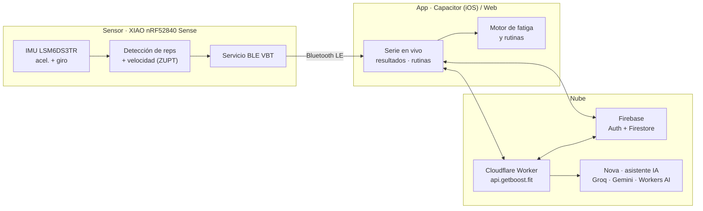

<p align="center">
  
</p>

<p align="center">
  <a href="https://getboost.fit"></a>
  <a href="https://app.getboost.fit"></a>
  
  
</p>

<p align="center">
  <b>Sensor de entrenamiento basado en velocidad (VBT) que se fija con imanes a la barra,<br>
  mide cada repetición con una IMU y la manda por Bluetooth a la app.</b>
</p>

---

## Qué es BOOST

BOOST es un dispositivo de **Velocity Based Training**: una pastilla de 57 × 31 × 17 mm que se
pega con imanes al eje de la barra. Adentro tiene una IMU de 6 ejes (acelerómetro + giroscopio)
y un nRF52840. En cada repetición calcula la **velocidad media y pico de la fase concéntrica**
(m/s), la **potencia** (W) y la **pérdida de velocidad dentro de la serie**; con eso la app indica
cuándo cortar, antes de acumular fatiga sin estímulo.

El repositorio reúne el producto: firmware del sensor, app móvil, back-end, sitio web,
sistema de diseño y hardware.

## Cómo funciona



1. **Abrir la app → conectar por Bluetooth → tocar "Comenzar serie".** El sensor se calibra solo
   en los segundos en que la barra está apoyada.
2. El firmware detecta cada repetición, integra la velocidad con corrección por velocidad cero
   (ZUPT) y manda un paquete por rep.
3. La app muestra la serie en vivo, calcula la pérdida de velocidad y guarda el historial en
   el teléfono y en Firestore.
4. **Nova**, el asistente, responde con los datos reales del atleta y con una base de evidencia
   científica citada (fichas con autor y año en `knowledge.js`); la próxima carga la calcula el
   servidor, no el modelo.

## Estado

| Pieza | Estado |
|---|---|
| **Firmware** | Completo. 52 tests pasando en PC contra dobles de prueba (bus I²C, flash NOR y stack BLE simulados). Pendiente: primer arranque en la placa. |
| **App** (`app-ios/`) | Diseño final integrado en Capacitor. Publicada en la web; build de iOS en la nube con Codemagic. |
| **Back-end** | Desplegado: Firebase (Auth + Firestore con reglas probadas) y Worker de Cloudflare con límites de uso, consentimientos y tope diario. |
| **Sitio** (`landing/`) | En producción en [getboost.fit](https://getboost.fit). |
| **Hardware** | Prototipo definido (57 × 31 × 17 mm, carcasa impresa). Placas en camino. |

> [!IMPORTANT]
> **El criterio que valida el producto:** contar repeticiones de press de banca con 95 % de
> precisión en un gimnasio real, contra conteo por video. Las métricas actuales del firmware
> salen de señal sintética y no se presentan como medición.

## Estructura del repositorio

```
BOOST/
├── firmware/          Firmware del sensor (C++, PlatformIO) + tests de PC y herramientas Python
├── app-ios/           App de lanzamiento: Capacitor + capa nativa (Swift)
│   ├── src/velo/      Bluetooth, cuentas, datos, pagos, Nova, fatiga, legales
│   ├── backend/       Reglas de Firestore + Cloudflare Worker (Nova, borrado de cuenta)
│   └── docs/          Back-end, build en la nube, integración y base de conocimiento de Nova
├── app/               PWA con Web Bluetooth + herramientas internas (/grabar, /ajustes, /log)
├── landing/           Sitio público (HTML/CSS/JS sin build, Cloudflare Pages)
├── design-system/     Tokens y componentes de la app (React + Vite), sincronizado con Claude Design
├── tools/             Scripts que mantienen firmware y app en el mismo protocolo
├── hardware/          Ficha del prototipo, lista de materiales y carcasa (.3mf)
├── .github/           Recursos del README
└── codemagic.yaml     Build de iOS en la nube (sin Mac)
```

## Stack

| Capa | Tecnología |
|---|---|
| Hardware | Seeed XIAO nRF52840 Sense · IMU LSM6DS3TR · LiPo 402535 · imanes de neodimio |
| Firmware | C++ · PlatformIO · Bluetooth LE · `make` para build y tests en PC |
| App | JavaScript · Capacitor 7 · Swift (Live Activity, plugin propio) · RevenueCat |
| Back-end | Firebase Auth + Firestore · Cloudflare Workers · rate limiting de Cloudflare |
| IA | Groq (gpt-oss-120b) · Gemini Flash · Gemma en Workers AI como respaldo |
| Web | HTML/CSS/JS sin dependencias · Cloudflare Pages |
| Diseño | React + Vite · Claude Design |

## Primeros pasos

Requisitos: **Node 22+**, **Python 3**, **PlatformIO** (solo para flashear la placa) y
**Java 21** (emulador de Firestore).

<details>
<summary><b>Firmware</b></summary>

```bash
cd firmware
make test          # 52 tests en PC, sin placa
make params        # verifica que app/js/params.js coincida con protocol.h
pio run -t upload  # compilar y flashear la placa
```

Antes de conectar hardware leer [`firmware/docs/BRINGUP.md`](firmware/docs/BRINGUP.md).
</details>

<details>
<summary><b>App</b></summary>

```bash
cd app-ios
npm install
npm run preview    # http://localhost:5173
```

El proyecto iOS se genera y firma en la nube: ver [`app-ios/docs/BUILD-NUBE.md`](app-ios/docs/BUILD-NUBE.md).
</details>

<details>
<summary><b>Back-end</b></summary>

```bash
cd app-ios/backend
npm install
npm test             # reglas de Firestore contra el emulador
npm run test:worker  # Worker de punta a punta contra emuladores de Auth y Firestore
```

Variables locales en `worker/.dev.vars` (plantilla: `worker/.dev.vars.example`).
Despliegue y secretos: [`app-ios/docs/BACKEND.md`](app-ios/docs/BACKEND.md).
</details>

<details>
<summary><b>Sitio y sistema de diseño</b></summary>

```bash
cd design-system && npm install && npm run dev   # galería de componentes
```

El sitio no tiene build: se sirve tal cual desde `landing/`. Comando de despliegue en
[`landing/README.md`](landing/README.md).
</details>

## Documentación

| Documento | Contenido |
|---|---|
| [`firmware/docs/PROTOCOL.md`](firmware/docs/PROTOCOL.md) | Contrato BLE entre sensor y app |
| [`firmware/docs/DECISIONS.md`](firmware/docs/DECISIONS.md) | Decisiones de diseño del sensor y sus motivos |
| [`firmware/docs/PLAN.md`](firmware/docs/PLAN.md) | Plan del firmware y registro de riesgos |
| [`app-ios/docs/BACKEND.md`](app-ios/docs/BACKEND.md) | Arquitectura y despliegue del back-end |
| [`hardware/PROTOTIPO.md`](hardware/PROTOTIPO.md) | Especificación física del sensor |

## Licencia

Software y diseños propietarios. © 2026 BOOST. Todos los derechos reservados.
Ver [`LICENSE`](LICENSE).

<p align="center"><sub>Diseñado y desarrollado en Montevideo, Uruguay.</sub></p>
